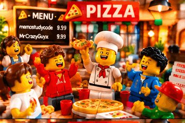

<!-- Profile README for github.com/pizzafeastbuddies -->
<h1 align="center">🍕 Pizza Feast Buddies 🍕</h1>

  

  

  
  
  

---

### 👋 About us
“We brought you pizza” is our way of saying: we’re here to contribute, not just watch.

- 🤝 A team of builders ready to contribute to the GitHub community
- 🚀 Joining hackathons to collaborate, experiment, and build together
- 🔭 Currently working on **[tritobol-token_optimizer-](https://github.com/pizzafeastbuddies/tritobol-token_optimizer-)**
- 🌱 Always learning something new
- 💬 Open to exchanging ideas and collaborating on community projects
- 🍕 Pizza is our metaphor for bringing something to the table—not a food fandom

### 🔑 Ownership & how this account is used
This official team account is fully owned by **William Leong** ([@memostudycode](https://github.com/memostudycode)) **|** **Abhishek** ([@MrCrazyGuyx](https://github.com/MrCrazyGuyx)).

- 👑 **William Leong** ([@memostudycode](https://github.com/memostudycode)) — core founder
- 🤝 **Abhishek** ([@MrCrazyGuyx](https://github.com/MrCrazyGuyx)) — co-founder

They founded it as a shared team account. When there’s a hackathon collaboration, both of them—or either one of them—use this account as the team account, and participating accounts are added on as contributors.

### 🧑‍🤝‍🧑 Latest collaborators zone
Hacking with us right now: [@memostudycode](https://github.com/memostudycode) | [@MrCrazyGuyx](https://github.com/MrCrazyGuyx) | [@jaygur9977](https://github.com/jaygur9977) | [@codewithsami1234](https://github.com/codewithsami1234)

More collaborators will be added here — you’re welcome to join us and hack together. 🍕

### 🎪 Our hackathon fields
The platforms where we look for our next hackathon — click a badge to visit.

  
  
  

- 🤖 LabLab.ai | [lablab.ai](https://lablab.ai/)
- 🛠️ Devpost | [devpost.com](https://devpost.com/)
- 🌐 TAIKAI | [taikai.network](https://taikai.network/)

This list is still open — more hackathon fields will be added as we explore them.

### 📫 Contact zone
Reach us directly — click a badge.

  
  

- ✉️ Email | [williabhiteam@protonmail.com](mailto:williabhiteam@protonmail.com)
- 💬 Discord | [Chat with William](https://discord.com/users/1559741800585891951)
- 🕓 Abhishek’s contact isn’t available yet — it will be added here as soon as it is.

### 🛠️ Our participants’ tech stacks · still growing
Every participant is welcome to add their own tech stack here. This list grows with the people who contribute to our team.

  

### 📊 GitHub stats

  
  

  

### 🏆 Trophies

  

### 📈 Contribution graph

  

### 🐍 Snake eating our contributions

  

### 😂 Random dev joke

  

---

<i>"We brought you pizza—our ideas, our code, and our willingness to contribute."</i> 🍕

